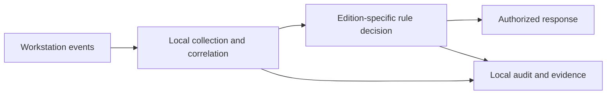

# TrustID — public architecture

**English · [Français](architecture.md)**

TrustID is a family of local workstation protection products. The catalogue distinguishes **v1.5**, a proven edition for SMEs and security-conscious individuals, and **v3**, an evolution for workstations. Capabilities documented for v3 must not be attributed retroactively to v1.5.

Processing combines workstation signals, rules, and response mechanisms. The v3 technical documentation describes multiple detection layers and local orchestration; this diagram is neither an API specification nor a claim of universal coverage. Required privileges, host impact, and permitted operations must be checked for each deployment profile.

Separate v3 technical dossiers exist for Windows and Linux. The existence of a Linux package alone does not prove full functional parity or production qualification. See [evidence and limits](evidence.en.md).
