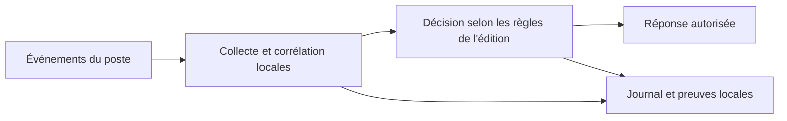

# TrustID — architecture publique

**Français · [English](architecture.en.md)**

TrustID est une famille de protection locale du poste. Le catalogue distingue **v1.5**, édition éprouvée pour PME et particuliers avertis, et **v3**, évolution destinée aux postes de travail. Les deux éditions sont présentées séparément : une capacité documentée pour v3 ne doit pas être attribuée rétroactivement à v1.5.

Le traitement associe des signaux du poste, des règles et des mécanismes de réponse. La documentation technique v3 décrit plusieurs couches de détection et une orchestration locale ; ce schéma n'est pas une spécification d'API ou une garantie de couverture universelle. Les droits nécessaires, l'impact sur le poste et les opérations permises doivent être vérifiés dans le profil de déploiement choisi.

Les déclinaisons Windows et Linux v3 disposent de dossiers techniques distincts. Le seul fait qu'un paquet Linux existe ne démontre ni parité fonctionnelle totale ni qualification en production. Voir [preuves et limites](evidence.md).
